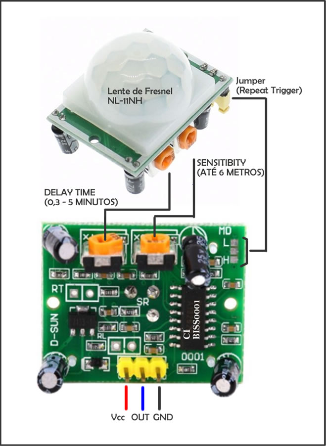
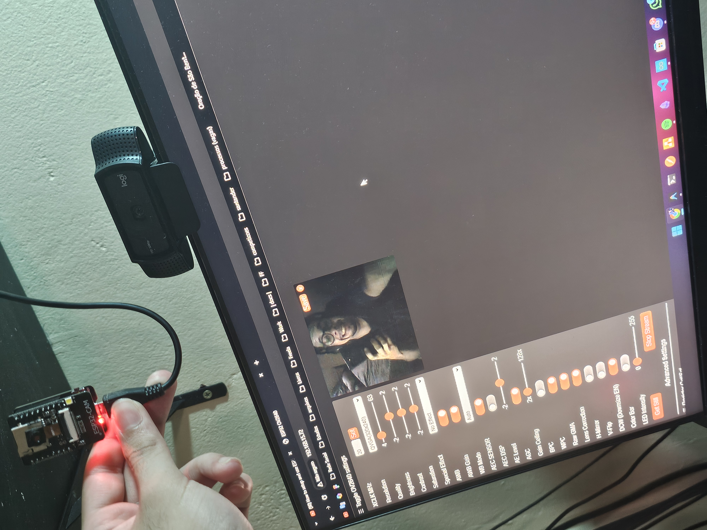
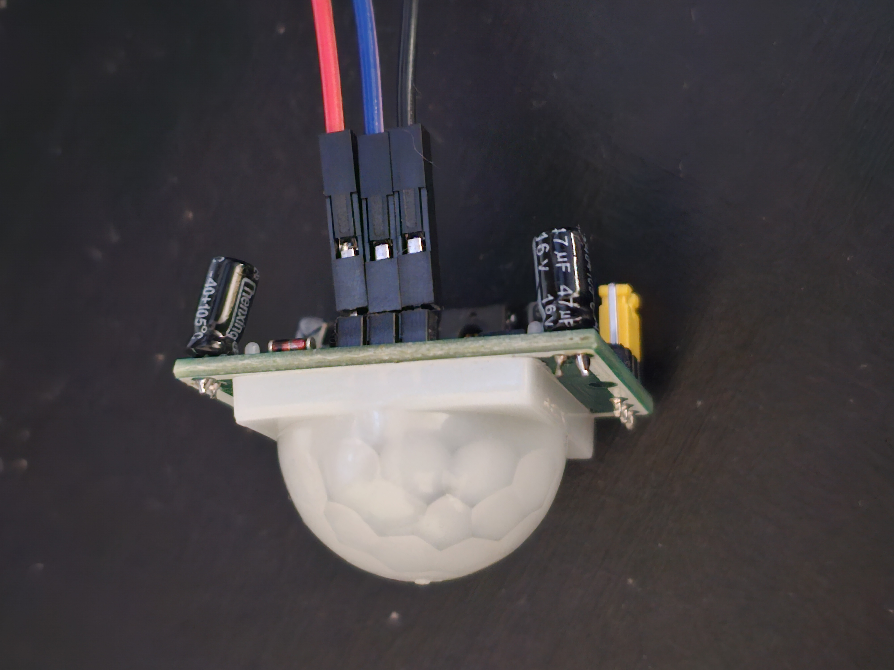

## Anotações & Progresso do Projeto

> [!NOTE]
> Aqui terá toda as informações de como foi desenvolvido o projeto IoT - Reconhecimento facial do meu TCC

[08/02/2026 - domingo]: Ontem (07/02/2026) sábado chegou o último dispositivo, o ESP32-CAM. hoje vamos dar iniciativa nas pesquisas sobre todos os dispositivos para entender melhor para que serve e como devo conectá-los e programá-los.

**Padrão de perguntas para cada componente:**

1. Oque é?
2. Oque cada parte do componente é?
3. Para que serve? (sua utilidade):
4. Onde deve ser usado?
5. Quais outros componentes são compatíveis com (nome_dispositivo)?

**perguntas globais**

- Onde deve ser programado (IDE)?
- Posso ser usado outra linguagem e depois compilar para a original (exemplo de pythop para arduino)?

### O que fiz hoje

1. Encontrei um site para simular meus dipositivos chamado [wokwi.](https://wokwi.com/)
2. Entrei nesse [vídeo](https://www.youtube.com/watch?v=mdaM53qIYgk&t=78s) e segui o tutorial. (não compactua com o escopo do meu projeto)
3. Imagem do sensor pir

1. até o momento percebi que o meu MB serve para passar os codigos e vou fazer as conexão de tudo feito depois porem ainda não entendi como fazer isso, vou deixar para o próximo dia

horário do termino: 20:26

---

[09/02/2026 - segunda]:

1. Conectei o dispositivo ao PC (após 1 hora de tentativas).
2. Realizei o teste inicial na placa **ESP32-CAM-MB** subindo um código para alternar o LED embutido a cada 2 segundos.
3. Configurei o **ESP32-CAM** na rede local utilizando o exemplo `CameraWebServer`.
4. Obtive imagens em tempo real acessando o IP local do dispositivo.

---

[10/02/2026 - terça]:

### Resumo

Hoje, às 17:17, tive um resultado acima do esperado: consegui fazer com que o dispositivo capturasse uma foto ao detectar movimento pelo **sensor PIR** e a enviasse automaticamente para o **Telegram**, por meio do bot `SecurityHomeJX_bot` (criado também hoje).

> [!NOTE]
> Isso representa um grande avanço, pois antes eu já estava considerando comprar equipamentos adicionais para concluir o projeto sem passar pela etapa de prototipagem.

### O que fiz

1. Preparei 3 fios (vermelho, azul e preto), cortando uma das pontas de cada um para expor o cobre.
2. Conectei os fios ao **Sensor PIR** conforme a tabela abaixo.
3. Conectei a outra extremidade dos fios (lado intacto) ao **ESP32-CAM-MB**.
4. Criei o bot `SecurityHomeJX_bot` no Telegram para receber as fotos capturadas.

### Conexões

#### Sensor PIR → Fios

| Pino do Sensor |   Fio    |
| :------------: | :------: |
|   **_VCC_**    | Vermelho |
|   **_OUT_**    |   Azul   |
|   **_GND_**    |  Preto   |

#### ESP32-CAM-MB → Fios

| Pino da Placa |  Sinal (Fio)   |
| :-----------: | :------------: |
|   **_5V_**    | VCC (Vermelho) |
|   **_GND_**   |  GND (Preto)   |
| **_GPIO 13_** |   OUT (Azul)   |

> A montagem ficou no estilo "sanduíche" — uma gambiarra criativa com os componentes disponíveis. 🛠️

### Protótipo Final

|                    Protótipo - Final                    |          ESP32-CAM e ESP32-CAM-MB (adaptado)           |                 Sensor PIR (adaptado)                 |
| :-----------------------------------------------------: | :----------------------------------------------------: | :---------------------------------------------------: |
|  |  |  |

---

[25/03/2026 - quarta]:
Oque foi feito?

- Modificação do artigo.
- Arquitetura (servidor/dispositivo).

Análise técnica para resolver algumas questões sobre os testes do **prototipo:***

1. **Alta latência:** Por que o HTTP está lento nos testes?
1. O `HTTP` é um protocolo `"pesado"` para um ESP32. Para cada foto, ele precisa abrir uma conexão `TCP`, fazer a handshake `TLS` (se for `HTTPS`, como o `Telegram`), enviar cabeçalhos gigantes e depois fechar a conexão. Isso gera a latência que eu percebi. O Wi-Fi do ESP32 não é `"lento"` (suporta 802.11b/g/n), mas o processamento dessa pilha de rede consome muita **CPU** e **RAM**.
1. MQTT para Imagens: O "Pulo do Gato"
1. O MQTT é muito mais rápido porque a conexão fica aberta. Quando o sensor PIR dispara, o ESP32 simplesmente joga os bytes da imagem no tópico, sem burocracia.
1. **O desafio:** A biblioteca padrão `PubSubClient` (muito usada no Arduino) tem um buffer padrão de apenas 128 ou 256 bytes. Uma foto VGA tem cerca de 20KB a 30KB.
1. **Solução:** Usar uma biblioteca mais moderna como a `AsyncMqttClient`.
1. Como o Python irar receber isso?
1. No lado do servidor, usarei a biblioteca `paho-mqtt`. O fluxo é simples:
1. O Python se conecta ao **Broker MQTT** (presisarei de um Mosquitto).
1. Ele se "inscreve" no tópico (ex: sala/camera1).
1. Quando a imagem chega, o `paho-mqtt` entrega um array de bytes (payload).
1. O Python salva esses bytes como um arquivo `.jpg` ou os passa diretamente para o OpenCV/FaceNet.
1. Proposta de Ação (ATIKA Strategy)
1. Antes de escrever mais no artigo, preciso validar o MVP (Minimum Viable Product).
1. Preciso escrever um script python (Subscriber) para receber as imagens e as condigurações necessárias para o ESP32 conseguir enviar arquivos maiores que o padrão via MQTT.

 > [!NOTE]
>
> Preciso instalar um Broker MQTT (Mosquitto) no pc/servidor para ESP32 e o Python poderem conversar.

---

[16/04/2026 - quinta]:

O que fiz hoje

1. **Configuração do Ambiente:**
    - Criação de um ambiente virtual Python (`.venv`) para gerenciar as dependências do projeto de forma isolada.
    - Instalação da biblioteca `paho-mqtt` no servidor.
2. **Desenvolvimento do Servidor MQTT (Python):**
    - Criação do script `src/server/mqtt_receiver.py` que atua como **Subscriber**.
    - Lógica implementada para receber o payload binário da imagem e salvá-lo automaticamente no diretório `docs/images/received/`.
3. **Validação do MVP:**
    - Criação do script `src/server/publisher_test.py` para simular o comportamento do ESP32 enviando imagens via MQTT, garantindo que o servidor Python está processando os dados corretamente.

### Próximos Passos

- Instalar e configurar o Broker **Mosquitto** no PC local.
- Modificar o código do **ESP32-CAM** para enviar as fotos via MQTT em vez de HTTP, utilizando a biblioteca `AsyncMqttClient` conforme planejado na estratégia técnica.
- Integrar o servidor Python com o **OpenCV** para reconhecimento facial.

horário do termino: 15:45

---

[09/05/2026]:

Acabei perdendo meu servidor MQTT, mas em troca descobri a causa de falsas detecções de movimento que tinha em meu projeto.

O conclito de Pinos (Causa dos disparos falsos)

No meu código `CameraWebServer.ino` tinhe definido o PIR_PIN como 3 porem como eu tinha colocado no dispositivo o GPIO 13 -> OUT (Azul) um problema.

O problema: O GPIO 3 no ESP32-CAM é o pino RX0 (Recepção Serial). Quando eu iniciava a comunicação serial (Serial.begin(115200)), qualquer ruído elétrico na linha serial ou dados chegando pelo cabo USB são interpretados pelo código como "movimento". Isso explica por que ele envia fotos mesmo sem ninguém no quarto.

OBS: Ainda estou tendo problema de latência mas agora estou totalmente pronto para migrar para MQTT.

---

[17/08/2026 - segunda]:

### Nova Abordagem: Transmissão de Vídeo em Tempo Real para App Kotlin

Hoje foi tomada a decisão de reformular a arquitetura do projeto: em vez do fluxo anterior com servidor intermediário, implementaremos uma nova ideia onde o **ESP32-CAM transmite o vídeo em tempo real diretamente para um aplicativo Android desenvolvido em Kotlin**.

O aplicativo móvel funcionará como um **painel de controle (dashboard)**, permitindo:
1. Visualizar o feed de vídeo ao vivo (stream da câmera) com baixa latência.
2. Enviar comandos de controle diretamente ao ESP32.
3. Monitorar o status e eventos do dispositivo.

**Ações realizadas hoje:**
- Criação da branch dedicada: `feature/esp32cam-stream-kotlin-app`.
- Limpeza dos códigos legados de dispositivo e servidor para reiniciar o desenvolvimento com uma base limpa e focada nessa nova arquitetura.
- Planejamento do novo firmware para o ESP32-CAM e da estrutura do aplicativo mobile em Kotlin.

---

[29/08/2026 - sábado]:

### Sistema funcionando de ponta a ponta 🎉

Hoje o projeto saiu do "compila e passa nos testes" para **funcionando no
hardware real**. Cadastrei meu próprio rosto pelo app, andei pelo ambiente em
várias posições e o reconhecimento acertou — inclusive com uma segunda pessoa.

Desde o último commit (17/08) o escopo cresceu muito: firmware com PIR + relé,
servidor Python com OpenCV/dlib e o app Kotlin com 4 telas reais. Mas o dia foi
gasto quase todo caçando 5 problemas que só aparecem quando tudo roda junto.

### Os 5 problemas que travavam o funcionamento

1. **Smart App Control do Windows 11 bloqueava o `dlib`.**
   O import quebrava com "uma política de Controle de Aplicativo bloqueou este
   arquivo". Não era versão de Python nem falta de compilador — era o antivírus
   do sistema barrando `.pyd` sem assinatura. Precisei desligar o Smart App
   Control (é **irreversível** sem reinstalar o Windows).
   Receita que funcionou, sem precisar de Build Tools do Visual Studio:
   Python 3.12 + `dlib-bin` (wheel pronto) + `face_recognition` com `--no-deps`
   + `setuptools<81` + `numpy==1.26.4`.

2. **IP errado do servidor.** O app e o firmware apontavam para
   `192.168.15.10`, mas meu PC é `192.168.15.6`. O erro no app só dizia
   "não foi possível conectar", sem falar o endereço. Corrigi e fiz o app
   **mostrar qual endereço falhou** e testar `/health` antes de salvar.

3. **A câmera está montada de cabeça para baixo — e o dlib não detecta rosto
   invertido.** Esse foi o achado do dia. Todo scan devolvia `no_face` mesmo
   com pessoas cadastradas. Medi no mesmo quadro:

   | Imagem | Rostos encontrados |
   | :--- | :---: |
   | original (como sai da câmera) | **0** |
   | girada 180° | **1** |

   Solução: o servidor agora **gira o quadro antes de reconhecer**
   (`rotation` em `/detect`, `/scan` e `/enroll`, com padrão `ROTATION` no
   `.env` para o fluxo do PIR). A detecção é gravada já girada, então a
   miniatura no app também sai na posição certa.

4. **Timeout curto abortava o cadastro.** O servidor respondia `201 Created`,
   mas o app desistia em 8 s enquanto o dlib codificava as amostras — a pessoa
   era criada e a tela acusava erro. Separei em dois perfis: 8 s para consultas
   e 90 s para as rotas de visão computacional.

5. **A lista de Pessoas nunca recarregava.** Como o app não usa `NavHost`, o
   ViewModel fica preso à Activity e o `refresh()` do `init` roda uma única
   vez. Eu cadastrava alguém e voltava para uma lista vazia. No log do servidor
   dava para ver: um único `GET /people` no início e nunca mais.

### O que também ganhei hoje no app

- **Editar dispositivo** (nome, IP, portas) — antes só dava para apagar.
- **Orientação por dispositivo** (0/90/180/270), que gira o vídeo ao vivo e
  acompanha o reconhecimento no servidor.
- **Moldura por status** nas detecções: verde com o nome quando reconhece,
  vermelha "Desconhecido" quando não.

### Anotações para não esquecer

- O `FACE_SERVER_URL` é **compilado no firmware**: se o IP do PC mudar, tenho
  que regravar a placa. O IP do ESP32 também muda a cada boot (DHCP) —
  preciso fazer reserva no roteador.
- A porta 8000 precisa de regra de entrada no firewall do Windows para o
  celular alcançar o servidor.
- O ESP32-CAM aceita **um único cliente de stream** por vez.
- Se eu endireitar a câmera, tenho que zerar a orientação nos **dois** lugares:
  no dispositivo pelo app e no `ROTATION` do `.env`.

### Testes

| Onde | Situação |
| :--- | :--- |
| Firmware | compila limpo — 35% da flash, 22% da RAM |
| Servidor | 38 testes `pytest` |
| App | 18 unitários + 4 instrumentados |

horário do termino: 22:49